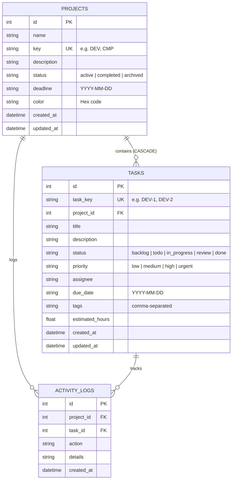

# DevFlow – Full-Stack Issue & Task Tracker

[](https://nodejs.org/)
[](https://expressjs.com/)
[](https://www.sqlite.org/)
[](https://nodejs.org/api/test.html)
[](https://opensource.org/licenses/MIT)

**DevFlow** is a modern, responsive full-stack issue and task tracking platform built with **Node.js**, **Express.js**, **SQLite/MySQL**, and modern **vanilla HTML5 / CSS3 / JavaScript**. It empowers teams to create project workspaces, assign and prioritize tasks, manage visual Kanban workflows with drag-and-drop, monitor real-time completion velocity, and stay ahead of deadlines.

---

## 🚀 Key Features

- **Project Workspaces**: Create, edit, and organize multiple projects with custom keys (`DEV`, `CMP`, `MOB`), deadlines, brand colors, and status indicators (`active`, `completed`, `archived`).
- **Interactive Kanban Board**: Multi-column board (`Backlog`, `To Do`, `In Progress`, `Review`, `Done`) featuring instant drag-and-drop status transitions with optimistic updates.
- **Responsive Data Table**: Sortable columns, search highlighting, pagination controls (10/20/50 per page), and quick action controls.
- **Dynamic Dashboard Metrics**: Real-time status summaries, active workload counters, QA/review counters, completion velocity progress bar, and overdue alert diagnostics.
- **Multi-Filter & Real-Time Search**: Debounced instant search across titles, descriptions, tags, and keys (`DEV-1`), paired with priority filters (`Urgent`, `High`, `Medium`, `Low`), status filters, and an overdue toggle.
- **Deadline Tracking**: Automated relative time calculations ("⚠️ 3d overdue", "⚡ Due today", "⏰ Due tomorrow", "In 5 days") with visual warning indicators.
- **Relational Database with Foreign Key Cascades**: Persistent storage using SQLite (`better-sqlite3` with fallback to built-in `node:sqlite`), supporting full foreign key referential integrity (`ON DELETE CASCADE`), database indexes, and MySQL compatibility.
- **RESTful API**: Comprehensive CRUD endpoints for projects and tasks with schema validation, structured error codes (400, 404, 409, 500), pagination, sorting, and activity auditing.
- **In-App Interactive API Documentation**: Built-in REST API Explorer rendering all routes, request bodies, query parameters, and cURL examples directly from `/api/docs/spec`.
- **Modern Web Standards**: Native HTML5 `<dialog>` elements with accessibility attributes, backdrop blur, and progressive enhancement light-dismiss fallbacks.

---

## 🛠 Tech Stack

| Layer | Technology | Details |
|---|---|---|
| **Backend Runtime** | Node.js (v18+ / v22+) | Native ES modules / CommonJS with built-in test runner (`node:test`) |
| **Web Framework** | Express.js (v4.21+) | REST routing, CORS, JSON parsing, error middleware |
| **Database** | SQLite / MySQL | Zero-config file database (`devflow.db`) with relational constraints and indexes |
| **Frontend** | HTML5, CSS3, Vanilla JS | Semantic markup, CSS Custom Properties, Glassmorphism, Native `<dialog>` |
| **Testing** | Node.js Test Runner | Automated integration tests for all REST endpoints |

---

## 🗄 Relational Database Schema



---

## 📡 REST API Reference

All responses return a structured JSON format:
```json
{
  "success": true,
  "data": { ... },
  "pagination": { "page": 1, "limit": 20, "total": 15, "totalPages": 1 }
}
```

### Dashboard & System
| Method | Endpoint | Description |
|---|---|---|
| `GET` | `/api/health` | Service health status and uptime |
| `GET` | `/api/dashboard/stats` | Aggregated workspace counters, priorities, upcoming & overdue deadlines |
| `POST` | `/api/dashboard/seed?force=true` | Populate or reset sample projects and tasks |
| `GET` | `/api/docs/spec` | Full REST API JSON specification |

### Project Workspaces
| Method | Endpoint | Query / Body Parameters | Description |
|---|---|---|---|
| `GET` | `/api/projects` | `search`, `status`, `page`, `limit`, `sort`, `order` | List all projects with task counts and progress % |
| `POST` | `/api/projects` | Body: `{ name, key?, description?, status?, deadline?, color? }` | Create project (auto-generates key if omitted) |
| `GET` | `/api/projects/:id` | - | Get project details, task distribution, and recent activity |
| `PUT` | `/api/projects/:id` | Body: `{ name, description?, status?, deadline?, color? }` | Update project metadata |
| `DELETE`| `/api/projects/:id` | - | Delete project and cascade-delete all its tasks |

### Tasks & Issues
| Method | Endpoint | Query / Body Parameters | Description |
|---|---|---|---|
| `GET` | `/api/tasks` | `project_id`, `status`, `priority`, `assignee`, `overdue`, `q`, `page`, `limit`, `sort`, `order` | Filter, search, and paginate tasks |
| `POST` | `/api/tasks` | Body: `{ project_id, title, description?, status?, priority?, assignee?, due_date?, tags?, estimated_hours? }` | Create task (auto-assigns project key like `DEV-4`) |
| `GET` | `/api/tasks/:id` | - | Get task details by ID or key (e.g. `DEV-1`) |
| `PUT` | `/api/tasks/:id` | Body: `{ project_id, title, description, status, priority, assignee, due_date, tags, estimated_hours }` | Full task update |
| `PATCH`| `/api/tasks/:id` | Body: `{ status?, priority?, assignee?, ... }` | Partial update (used for Kanban drag-and-drop) |
| `DELETE`| `/api/tasks/:id` | - | Delete task |

---

## ⚡ Quick Start & Installation

### 1. Prerequisites
- **Node.js** v18.0.0 or higher (v22+ recommended)
- **Git**

### 2. Clone the Repository
```bash
git clone https://github.com/superbPrakhar/devflow.git
cd devflow
```

### 3. Install Dependencies
```bash
npm install
```

### 4. Configure Environment
Copy the sample environment file (default works out of the box with zero configuration):
```bash
cp .env.example .env
```

### 5. Start the Application
```bash
# Start production server
npm start

# Or start in watch mode for development
npm run dev
```

Open your browser and navigate to:
```
http://localhost:3000
```

### 6. Run Automated Tests
Execute the 18-suite end-to-end integration test runner:
```bash
npm test
```

---

## 🐙 GitHub Repository Setup & Push Guide

To upload this repository to your GitHub account at [https://github.com/superbPrakhar](https://github.com/superbPrakhar):

### Step 1: Create the repository on GitHub
1. Go to [https://github.com/new](https://github.com/new).
2. Repository name: **`devflow`**
3. Description: `DevFlow – Full-Stack Issue and Task Tracker (Node.js, Express, SQLite/MySQL, HTML/CSS)`
4. Set visibility to **Public** (or **Private**).
5. **Do NOT** check "Initialize with a README, .gitignore, or license" (these are already configured in this codebase).
6. Click **Create repository**.

### Step 2: Push your local codebase to GitHub

Run the following commands in your terminal:

```bash
# 1. Initialize git (if not already initialized)
git init -b main

# 2. Stage all project files
git add .

# 3. Create initial commit
git commit -m "feat: initial DevFlow full-stack issue tracker release"

# 4. Add the GitHub remote pointing to your profile
git remote add origin https://github.com/superbPrakhar/devflow.git

# 5. Push to GitHub
git push -u origin main
```

*(Alternatively, run the included `./push-to-github.sh` helper script).*

If you use SSH:
```bash
git remote set-url origin git@github.com:superbPrakhar/devflow.git
git push -u origin main
```

---

## 📁 Project Structure

```text
devflow/
├── .env.example              # Environment variables template
├── .gitignore                # Git ignore rules for node_modules, db, logs
├── README.md                 # Complete documentation & setup instructions
├── package.json              # Project scripts and dependencies
├── push-to-github.sh         # One-click helper script to push to GitHub
├── server.js                 # Server entry point & startup banner
├── src/
│   ├── app.js                # Express application factory & middleware stack
│   ├── config/
│   │   └── database.js       # SQLite connection, migrations, indexes, demo seed data
│   ├── routes/
│   │   ├── projects.js       # Project CRUD, filtering, pagination, stats
│   │   ├── tasks.js          # Task CRUD, multi-criteria filter, pagination, patch
│   │   ├── dashboard.js      # Dashboard analytics & metrics
│   │   └── docs.js           # OpenAPI REST specification
│   ├── middleware/
│   │   ├── validate.js       # Request body & query validation rules
│   │   └── errorHandler.js   # Standardized JSON error response handler
│   └── utils/
│       └── logger.js         # Colored HTTP request logger
├── public/                   # Frontend Single Page Dashboard
│   ├── index.html            # Semantic HTML5 with native dialogs and ARIA
│   ├── favicon.svg           # DevFlow SVG brand icon
│   ├── css/
│   │   └── styles.css        # Responsive dark UI with modern CSS variables
│   └── js/
│       ├── app.js            # Coordinator, view switcher, event handling
│       ├── api.js            # REST API client
│       ├── utils.js          # Formatters, priority badges, debounce
│       └── components/
│           ├── board.js      # Drag-and-drop Kanban board
│           ├── table.js      # Responsive data table with pagination
│           ├── projects.js   # Workspace project cards
│           ├── modals.js     # Native <dialog> modal controller
│           └── toast.js      # Accessible notifications
└── test/
    └── api.test.js           # Automated end-to-end integration test suite
```

---

## 📄 License

This project is licensed under the [MIT License](LICENSE).
